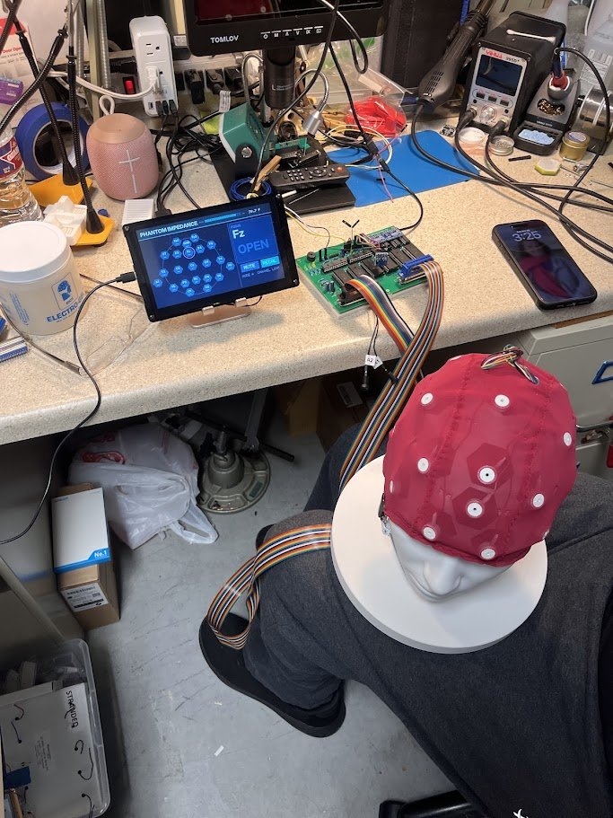
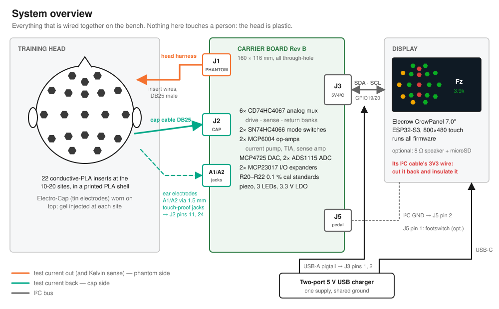
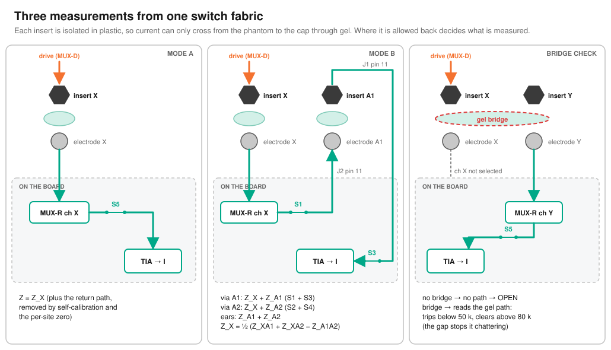

# EEG Head Phantom: Impedance Training Meter

A life-size 3D-printed head with conductive inserts at the 10-20 electrode sites, and a purpose-built meter that measures every electrode's gel contact and catches salt bridges. Students put a real Electro-Cap on the phantom, gel it, and watch each site turn green, so they can practise cap prep as many times as they like without a volunteer.

**Status (Nov 2026): working on the bench.** Self-calibration passes, all 22 channels read, a gelled Electro-Cap on the phantom reads in both measurement modes, and salt-bridge detection catches real gel bridges.

## What it does

- **Measures all 22 sites** (19 scalp sites, GND, A1, A2) with a ±2.5 µA, 31.25 Hz test current, and shows them on a 7" touch-screen head map: green ≤ 5 kΩ, amber to 10 kΩ, red above, grey when there's no contact.
- **Focus and feedback:** tap a site (or press a footswitch) and it is re-measured about three times a second, with a chime the moment it passes 5 kΩ. The pedal jumps to the next site that still needs work.
- **Two modes.** Mode A measures each site against its own electrode, for prepping. Mode B measures against the ear references the way a clinical meter does, then separates the site from the references arithmetically.
- **Salt-bridge detection** with no extra hardware: neighbouring pairs are checked continuously, steepest first, and an arrow points to the downhill site where the gel pooled.
- **Self-calibrates at every power-up** against three 0.1 % standards on the board, with a mid-scale check that tells you if anything is off.

## How it works, in one minute

Each conductive insert is isolated in plastic and wired to its own pin on a DB25 (the *head harness*). The cap plugs into a second DB25. The meter pushes a known AC current out through an insert and takes it back through the cap electrode above it, so the only thing joining the two is the gel the student applied. The voltage is read right at the connector pin (a four-wire Kelvin measurement), the current is measured rather than assumed, and impedance is their ratio.

The same switch fabric routes the current three ways: back through the site's own electrode (Mode A), through an ear reference (Mode B), or through a *neighbouring* electrode, which only conducts if gel has bridged the two:

**→ The full explanation, with the schematic, timing and calibration maths: [docs/how-it-works.md](docs/how-it-works.md)**

## Repository map

| Path | What's there |
|---|---|
| [`docs/how-it-works.md`](docs/how-it-works.md) | Theory of operation: measurement loop, analog front end, synchronous detection, calibration, Mode A/B, DC offsets, salt bridges, firmware loop |
| [`docs/build-guide.md`](docs/build-guide.md) | Parts, soldering order, board modifications, wiring, staged bring-up with expected readings |
| [`docs/using-the-meter.md`](docs/using-the-meter.md) | Running a training session: the screen, colours, footswitch, modes, alarms, sounds |
| [`docs/troubleshooting.md`](docs/troubleshooting.md) | Symptom → cause, from everything that went wrong during bring-up |
| [`docs/changelog.md`](docs/changelog.md) | Dated history and the lessons worth keeping |
| [`hardware/`](hardware/) | Carrier board Rev B: required modifications, Rev C fixes, [BOM](hardware/bom.csv), [pinouts](hardware/pinout.md), PCB images |
| [`firmware/`](firmware/) | Arduino sketch for the ESP32-S3 display, plus three diagnostic sketches |
| [`phantom/`](phantom/) | The printed head and its inserts |
| [`docs/archive/`](docs/archive/) | Original bench notes, unedited |

## Build one

1. Order parts from [`hardware/bom.csv`](hardware/bom.csv) and bare boards as described in [`hardware/README.md`](hardware/README.md#ordering-bare-boards).
2. Solder and modify the board: [build guide §2–3](docs/build-guide.md#2-solder-the-board). The Rev B boards need **six changes** (vertical DB25s, a hand-wired DAC, an ADC pin, a gain link, ear jacks, a separate 5 V feed), all listed in [`hardware/README.md`](hardware/README.md#changes-from-rev-b-as-fabricated).
3. Flash `firmware/phantom_meter_v2` with the [pinned toolchain](firmware/README.md#toolchain).
4. Bring it up one stage at a time: [build guide §5](docs/build-guide.md#5-bring-it-up-one-stage-at-a-time).

## What's verified, and what isn't

Verified on the bench (details and dates in the [changelog](docs/changelog.md)):

- Self-calibration: 2.50 µA drive on every standard, 4.7 kΩ check reading 4,708 Ω, short −0.8 Ω (27 Oct 2026).
- All 22 channels through a straight-through cable; per-site zero working.
- A gelled Electro-Cap on the phantom, read in Mode A and Mode B, with the two modes agreeing within 1–2 kΩ (8 Nov 2026).
- Salt-bridge detection on real gel bridges.

Known limits and open items:

- The salt-bridge thresholds (trip 50 kΩ, clear 80 kΩ) are starting values, to be tuned against more sessions on the phantom.
- Mode B allows for its two extra switches with a nominal +200 Ω rather than a measured offset.
- `PHANTOM_SCALE` (0.5) is a teaching calibration so a skinless phantom reads like a head; it is not a physical correction. Set it to 1.0 for true ohms.
- Hardware for a "Learn Harness" probe (J4, switch S6) is on the board but the feature was never written.
- The KiCad Rev B source files and the head's print files are not in the repository yet (see [`hardware/kicad/`](hardware/kicad/) and [`phantom/`](phantom/)).

## What was cut, and why

| Cut | Why |
|---|---|
| **The EEG signal generator** | Part of the original proposal (microvolt sine waves or EDF playback through the head). It was never built. The phantom is used for cap placement, gel technique and impedance/salt-bridge training, and nothing in this repo generates EEG signals. |
| **Second display (Sunton CYD 4.3")** | Bring-up started on it and the firmware supported both boards through a `PM_BOARD` switch. The bench instrument runs on the Elecrow CrowPanel 7.0", whose larger panel is easier to read at arm's length, so the CYD code was removed. The trimmed sources preprocess to exactly the same code as the original CrowPanel build; only comments changed. |
| **Three bring-up sketches** | `pm_panel_test`, `pm_touch_probe` and `pm_dac_hold` were for one-time display and DAC-adapter debugging. The three diagnostics that stay useful are kept. |
| **The MCP4725 adapter PCB** | Meant to fix the M1 footprint; its VDD connection was open and it cost days. Five jumper wires replaced it. |
| **ADC data-ready wire (J3 pin 5)** | Dropped in favour of polling, which made J3 four wires and the firmware portable between displays. |
| **Loop-back dongle** | Only needed for caps whose ear electrodes are inside the DB25. This cap's ears plug into jacks on J2. |

Everything removed from the firmware is recoverable at the git tag [`dual-display-snapshot`](https://github.com/bas-04/eeg-phantom-impedance-meter/tree/dual-display-snapshot).

**About the multiplexers:** the six CD74HC4067E chips came from an Amazon/AliExpress 10-pack. TI no longer makes the through-hole version (only SOIC/SSOP/TSSOP), so DIP parts sold today are old stock, remarks or clones, whatever the marking says. The design doesn't depend on them being genuine: their on-resistance sits outside the Kelvin loop or at a fixed virtual ground, calibration and the per-site zero remove what's left, and a bad chip fails the self-test. [More detail](hardware/README.md#about-the-multiplexers).

## Safety

This is laboratory teaching equipment for a plastic head. **It has no patient isolation and must never be connected to a person.**

## Credits

- **Dr. Mark Jones**, UTSA: Director Neurofeedback Program.
- **Sebastian Perez**, UTSA: Electrical Engineering Senior.
- Claude was used to assist with Design, firmware and documentation.

## License

Not chosen yet. Until a license is added, all rights are reserved by the authors. `firmware/phantom_meter_v2/pm_fonts.h` contains glyphs from Inter Display (SIL Open Font License 1.1).
