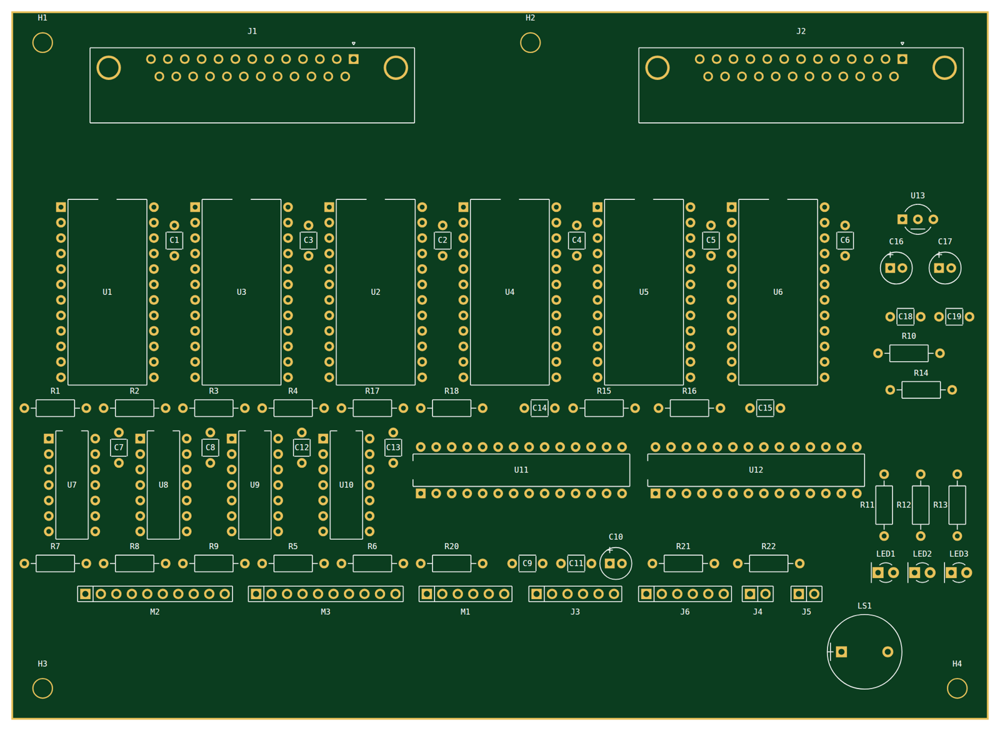
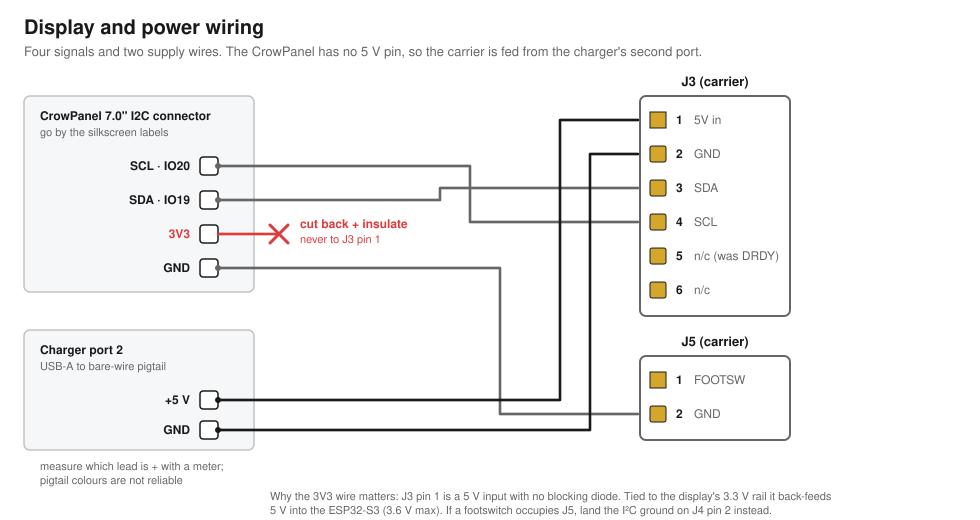

# Build and bring-up guide

From a bare Rev B board to a gelled cap on the phantom. Each bring-up stage has a number you should see; if you see it, go on, and if you don't, stop, because nothing downstream can work yet. Two evenings of soldering for a first-time builder.

> **This is teaching equipment for a plastic head.** It has no patient isolation. Never connect it to a person.

1. [Parts](#1-parts)
2. [Solder the board](#2-solder-the-board)
3. [Make the bench-board modifications](#3-make-the-bench-board-modifications)
4. [Wire the display and power](#4-wire-the-display-and-power)
5. [Bring it up, one stage at a time](#5-bring-it-up-one-stage-at-a-time)
6. [First session on the phantom](#6-first-session-on-the-phantom)

## 1. Parts

Everything is in [`hardware/bom.csv`](../hardware/bom.csv). Ordering the bare PCB is covered in [`hardware/README.md`](../hardware/README.md#ordering-bare-boards). The notes that save a re-order:

- **CD74HC4067E is a wide DIP** (0.600″ between rows). Buy *wide* 24-pin machined-pin sockets. Buy the chips as a 10-pack from Amazon/AliExpress; the through-hole version is obsolete at the big distributors ([why that's fine](../hardware/README.md#about-the-multiplexers)).
- **MCP23017-E/SP is a narrow 28-pin** (0.300″). Buy narrow sockets, not the wide EPROM kind.
- **ADS1115 modules must be the single-row 10-pin type**, pin order VDD GND SCL SDA ADDR ALRT A0 A1 A2 A3. Check the silkscreen before buying.
- **Any MCP4725 module** works, because it gets wired by label.
- **J1/J2 must be vertical (straight) female DB25s** on these boards.
- Electrolytics are 5 mm diameter on a 2.0 mm lead pitch.

Tools: temperature-controlled iron at 330–350 °C with a small chisel tip, 0.6–0.8 mm 63/37 leaded solder if you can get it, flush cutters, desoldering pump, a multimeter with continuity beep, tape to hold parts while you flip the board.

## 2. Solder the board

Lowest parts first, tallest last, so the board lies flat. Heat pad and lead together for two seconds, feed solder, remove solder, remove iron. **Nothing goes into a socket until section 5 says so.**

1. **Resistors R1–R22** (R15 and R16 stay empty). No polarity. Check that R20–R22 are the 0.1 % parts in the right places and that R17 (150 k) and R18 (200 k) are not swapped.
2. **Ceramic capacitors** C1–C9, C11–C15, C18, C19. No polarity.
3. **DIP sockets:** six wide 24-pin (U1–U6), four 14-pin (U7–U10), two narrow 28-pin (U11, U12). Solder two diagonal pins, check the socket is flat, then the rest. **The socket notch goes toward the square pad / the notch on the silkscreen.** This is the most common first-board mistake: check it twice.
4. **U13** (TO-92 regulator): flat face to the flat line on the silkscreen.
5. **Electrolytics** C10, C16, C17: longer lead (+) in the square pad, stripe on the can is negative.
6. **LEDs:** longer lead (anode) in the round pad; the flat on the rim matches the flat on the silkscreen.
7. **Header strips:** female 10 + 10 + 6 for M2, M3, M1; male 6 + 6 + 2 + 2 for J3, J6, J4, J5. Tape, solder one pin, check it stands straight, then the rest.
8. **LS1** piezo: not polarised, either way round.
9. **J1, J2** (vertical DB25) last, because they are tall. Solder all 25 pins and the two shield tabs; the tabs need more heat.
10. **ADS1115 modules** (M2, M3): solder their header pins pointing down. They plug in later.

## 3. Make the bench-board modifications

These are explained in [`hardware/README.md`](../hardware/README.md#changes-from-rev-b-as-fabricated). Do them now, before anything is powered:

- [ ] **R8:** solder a short wire across it (sense gain 1). The firmware ships with `G_SENSE = 1.0f` to match.
- [ ] **M3:** optionally clip pin 6 (ALRT) off the ADS1115 module that goes into M3.
- [ ] **M1:** if your MCP4725 module has an A0 pin, tie it to its GND pin. Then five female-to-male jumpers from the module to the M1 socket, **by label**: VCC→1, GND→2, SCL→3, SDA→4, OUT→5. Hole 6 stays empty. ([diagram](img/dac-wiring.svg))
- [ ] **Ear jacks:** two 1.5 mm touch-proof receptacles to the underside joints of J2 pin 11 (A1) and J2 pin 24 (A2), found by continuity from the front of J2. Then check 11 against 10 and 12, and 24 against 23 and 25, for shorts.

## 4. Wire the display and power

- **Signals:** CrowPanel I2C connector SDA (IO19) → J3 pin 3, SCL (IO20) → J3 pin 4. Go by the silkscreen labels: swapped SDA/SCL gives a completely dead bus with no other symptom.
- **I²C ground:** the connector's GND → J5 pin 2 (or J4 pin 2 if a footswitch uses J5).
- **The connector's 3V3 wire: cut it back and insulate it.** J3 pin 1 is a 5 V input with no blocking diode; 3V3 tied to it back-feeds 5 V into the ESP32-S3 and kills it.
- **Carrier 5 V:** a USB-A-to-bare-wire pigtail from the second port of the same two-port charger into J3 pin 1 (+5 V) and pin 2 (GND). Identify + with a meter, not by colour. One charger means one ground and both boards come up together.
- Keep the I²C wires under about 15 cm.
- **Don't run the display from a computer's USB port while testing I²C.** GPIO19/20 are the ESP32-S3's native USB pins and a USB host loads them. Upload from the computer, then move the display to the charger.

## 5. Bring it up, one stage at a time

Flash with the settings in [`firmware/README.md`](../firmware/README.md). Measurements are with a meter's black lead on GND.

### Stage 1: power only, all sockets empty

Pigtail into J3 pins 1–2, display not connected. Measure across **C17: 3.30 V ±0.1**. LED3 (power) lights, nothing is warm.
No 3.3 V → U13 or C16 is in backwards. Warm U13 or low rail → a short on the 3.3 V rail; find it now.

### Stage 2: U9 and U10

Power off, insert U9 and U10 notch to notch, power on.
- **U9 pin 14 (VREF): 1.65 V ±0.05.**
- U10 pin 1 is meaningless now, because the sense input floats until U3/U4 are in. To test the stage, jumper U10 pin 3 to U9 pin 14 and confirm U10 pin 1 follows to 1.65 V, then remove the jumper.

### Stage 3: the I²C devices

Power off. Insert U11 and U12, plug M2 and M3 in (VDD over the square pad), connect the M1 jumpers, connect the display. Flash **`pm_i2c_scan`** and power from the charger. It lists every address on the screen every three seconds:

| Expect | |
|---|---|
| 0x18 | display's panel-reset expander |
| 0x20, 0x21 | U11, U12 |
| 0x48, 0x49 | M2, M3 |
| 0x60 or 0x62 | M1 (generic or Adafruit) |
| 0x5D | touch; may only appear once a sketch has started touch |

Only display addresses → the bus is not reaching the carrier (check 3.3 V at U13, then SDA/SCL). One carrier address missing → see [troubleshooting](troubleshooting.md#i2c-and-power). Then measure **M1's VCC pin on the module itself: 3.3 V**. About 2.2 V means its power wire is open even though it answers on the bus.

### Stage 4: the multiplexers and self-calibration

Power off **both** charger ports. Ground yourself; these are CMOS analog switches. Straighten each chip's legs against the table so they drop into the machined sockets, insert U1–U6 (all face the same way) and U7–U8, and look along each row at eye level for a pin folded under the body.

Flash **`phantom_meter_v2`**. The calibration report appears before the head map:

| Line | Expect |
|---|---|
| 1.00 k standard | ≈ 1000 (fit anchor, always right) |
| **4.70 k check** | **≈ 4700, green within 150 Ω.** The one number that can be wrong. |
| 100 k standard | ≈ 100 000 (fit anchor) |
| short channel | a small residual, ohms |
| open channel | OPEN |
| drive column | ≈ 2.5 µA per standard; amber warning below half of that |

Bench result, 27 Oct 2026: drive 2.50 µA, check 4,708 Ω, short −0.8 Ω. On FAIL the screen names the standard and the likely part; **RETRY** reruns in place, so a bent pin can be fixed without a power cycle. Tap **CONTINUE**: the head map appears with every site OPEN, which is correct with nothing plugged in.

### Stage 5: a real measurement

Nothing on the board joins J1 to J2: in use, the insert, gel and electrode close the loop. So a test lead has to bridge the two connectors.

- Two DB25 **male** solder-cup plugs, a 4.7 kΩ resistor on short wires from **pin 1 of plug A to pin 1 of plug B**. A into J1, B into J2. Fp1 should show a reading; every other site stays OPEN.
- **Expect about 2.4 k on screen, not 4.7 k**: scalp sites are shown × `PHANTOM_SCALE` (0.5). For resistor tests in true ohms, set `PHANTOM_SCALE` to `1.0f` and reflash, or just halve your expectation.
- More leads, always pin N to pin N: 1 k on pin 14 (Fp2), 6.8 k on pin 22 (Cz), 22 k on pin 10 (Fz).
- Tap Fp1: the focus panel follows. Tap the header: the mode changes once per tap and the yellow LED1 follows Mode B.

### Stage 6: zero the sites

The standards return through U6 while sites 0–15 return through U5, and the two chips can differ by a few hundred ohms (on the bench a 4.72 k lead read 5.2 k before zeroing).

1. Plug a **straight-through DB25 male-to-male cable** (all 25 pins, not null-modem) between J1 and J2.
2. On the calibration PASS screen tap **ZERO SITES**, then **MEASURE**. All 22 paths are read in about six seconds; expect values within a few hundred ohms of zero, some negative. A site showing OPEN means that cable pin isn't wired.
3. Tap **SAVE**. The values live in flash and are subtracted from every Mode A reading. Redo this only if U1–U8 or a DB25 jack is ever replaced.

### Stage 7: salt-bridge bench test

A 470 Ω–1 kΩ resistor from the J1 pin of an uphill site to the J2 pin of its downhill neighbour, e.g. **J1 pin 16 (C4) to J2 pin 20 (T4)**, should raise a bridge alarm within one sweep. Other pairs are in [`archive/salt_bridge_pairs.txt`](archive/salt_bridge_pairs.txt).

### Voltages you can check at any time (powered, idle)

| Where | Expect | Meaning |
|---|---|---|
| C17 (+ to −) | 3.30 V | analog rail |
| U9 pin 14 | 1.65 V | VREF |
| U9 pin 1 | 1.65 V | DAC buffer at rest (DAC parked at VREF) |
| U9 pin 8 | 1.65 V | TIA output, no current |
| U9 pin 8 during a sweep | flickers around 1.65 V | ±2.5 µA × 200 k = ±0.5 V square wave |
| U1 pin 24, U7 pin 14, U11 pin 9 | 3.30 V | chip supplies |
| M2 ADDR / M3 ADDR | 0 V / 3.30 V | ADC addresses 0x48 / 0x49 |

## 6. First session on the phantom

1. Head harness into **J1**, Electro-Cap into **J2**, ear electrodes into the A1/A2 jacks.
2. Power on, wait for calibration PASS, **CONTINUE**.
3. Put the cap on the head and gel a few sites plus both ears. Watch them go from OPEN (grey) through red and amber to green, with a chime when the focused site passes 5 kΩ.

How to read the screen and run a training session: [using the meter](using-the-meter.md).
