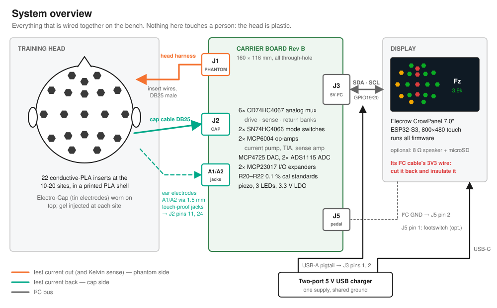
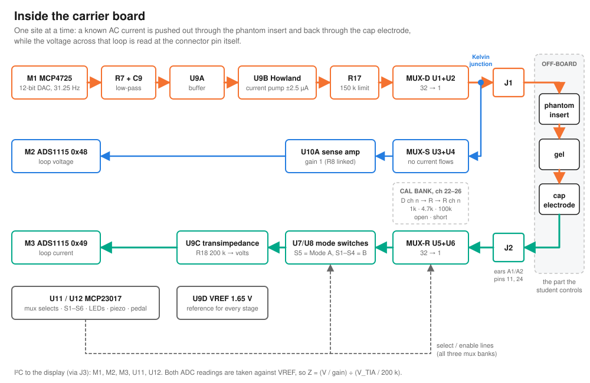
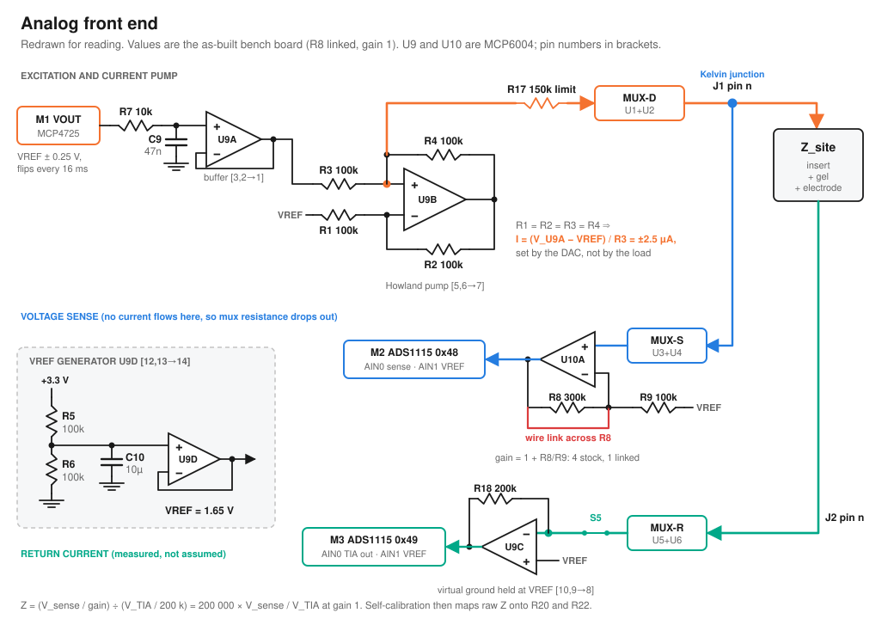
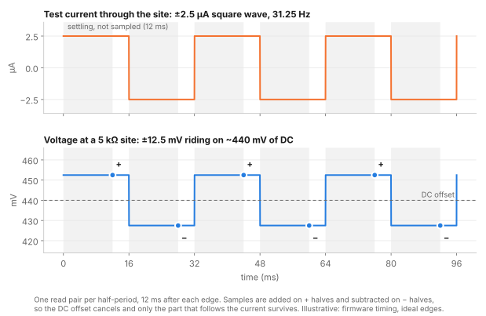
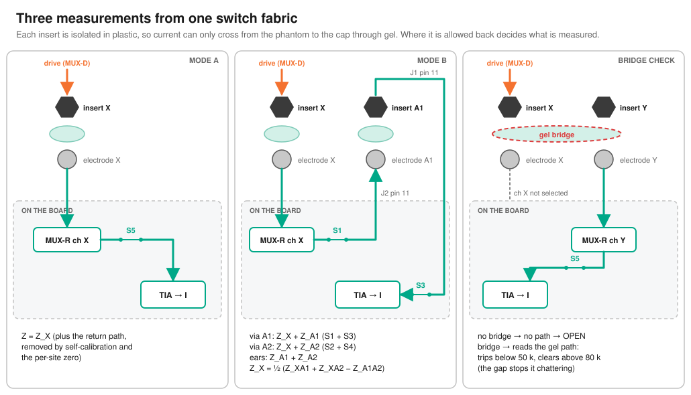
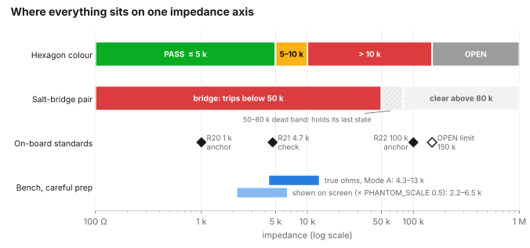
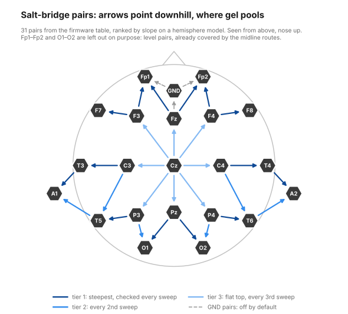
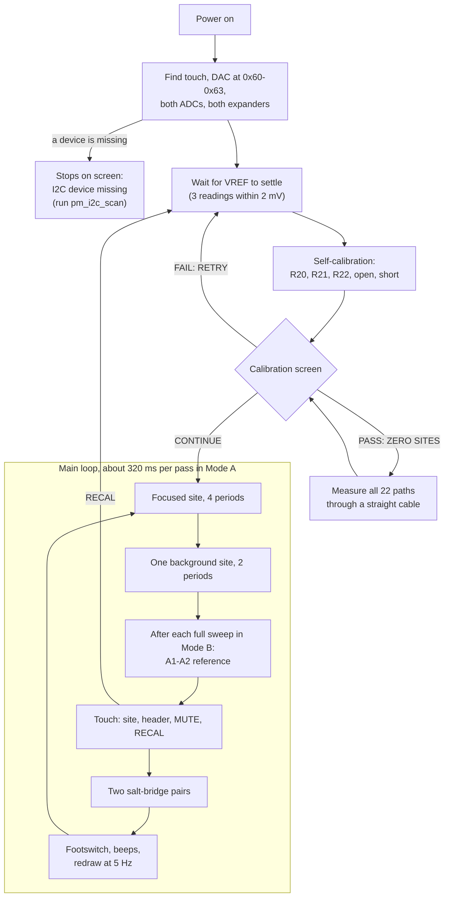

# How it works

This page explains the measurement from the electrode inwards: what is being measured, how the carrier board measures it, how the firmware turns two ADC readings into an impedance a student can act on, and how salt bridges are caught. Every section stands on its own.

- [1. What the meter is grading](#1-what-the-meter-is-grading)
- [2. The measurement loop](#2-the-measurement-loop)
- [3. The analog front end](#3-the-analog-front-end)
- [4. Synchronous detection: one number from a square wave](#4-synchronous-detection-one-number-from-a-square-wave)
- [5. Calibration: why only three resistors need to be precise](#5-calibration-why-only-three-resistors-need-to-be-precise)
- [6. Mode A and Mode B](#6-mode-a-and-mode-b)
- [7. Electrode DC offset and autoranging](#7-electrode-dc-offset-and-autoranging)
- [8. Phantom scale: making a plastic head read like a scalp](#8-phantom-scale-making-a-plastic-head-read-like-a-scalp)
- [9. Salt-bridge detection](#9-salt-bridge-detection)
- [10. The firmware loop and timing](#10-the-firmware-loop-and-timing)
- [11. Switch fabric and channel map](#11-switch-fabric-and-channel-map)

---

## 1. What the meter is grading

A clinical impedance check measures each electrode against the scalp. On this phantom there is no scalp: every 10-20 site is a separate conductive-PLA insert set into a non-conductive PLA shell, and each insert has its own wire to a DB25 connector (the **head harness**). The Electro-Cap goes on top, wired to its own DB25 as usual.

So for any site, the only path from the insert to the cap electrode above it is the **gel**. The meter drives a small current out through the insert's wire and takes it back through the cap electrode's wire. What it measures is

```
Z_site = insert + insert/gel junction + gel + gel/electrode junction + electrode
```

The insert and electrode are fixed. Everything that varies between a careless prep and a careful one, how much gel, how well it is worked in, whether the electrode is seated over the insert, is in the middle. That is the whole design idea: **the student's technique is inside the measurement loop**, so the number on the screen responds to exactly what they are doing.



## 2. The measurement loop



One site at a time:

1. **Drive.** A Howland current pump makes a ±2.5 µA square wave at 31.25 Hz. The drive multiplexer (MUX-D) connects it to the site's pin on **J1**, the phantom connector.
2. **The loop.** The current goes through the insert, the gel and the cap electrode, then comes back on the same pin number of **J2**, the cap connector.
3. **Return.** The return multiplexer (MUX-R) and a mode switch take it to a transimpedance amplifier (TIA), which turns the current into a voltage. The current is therefore **measured, not assumed**.
4. **Sense.** A third multiplexer (MUX-S) taps the voltage at the J1 pin itself, through a path that carries no current.

Step 4 is a **Kelvin (four-wire) connection**. The drive mux has around 150 Ω of on-resistance, and it varies with signal level, but that resistance sits *before* the point where the voltage is read, so it never appears in the answer. The sense mux carries no current, so its resistance drops no voltage. That is why cheap 74HC-family multiplexers are good enough here.

The impedance is then just Ohm's law on the two readings:

```
Z = (V_sense / G_SENSE) / (V_TIA / R18)          R18 = 200 kΩ, G_SENSE = 1 on the bench board
```

Both ADC channels are read differentially against the same mid-rail reference (VREF), so the ratio is insensitive to the absolute value of VREF and of the drive current. A board whose current pump delivers a fraction of its design current still reads the right impedance; it just reads it with more noise. That property is what let bring-up continue while the drive current was still low (see [changelog](changelog.md)).

## 3. The analog front end



| Stage | Parts | What it does |
|---|---|---|
| DAC | M1 (MCP4725 module) | Steps between VREF + 0.25 V and VREF − 0.25 V every 16 ms. The firmware measures VREF at start-up and centres the steps on it. |
| Filter + buffer | R7 10 k, C9 47 nF, U9A | Softens the DAC edges (corner ≈ 340 Hz) and gives the pump a low-impedance source. |
| Current pump | U9B, R1–R4 all 100 k | Improved Howland pump. With all four resistors equal, I = (V<sub>U9A</sub> − VREF) / R3 = ±0.25 V / 100 k = **±2.5 µA**, independent of the load. R1 returns to VREF, not ground, so the pump is centred on mid-rail. |
| Limit | R17 150 k | In series with the load, between the pump and the drive mux: a fault-current limit. A current source does not care about a series resistor while it stays within its output swing. |
| Return / TIA | U9C, R18 200 k | The return current lands on a virtual ground held at VREF. V<sub>TIA</sub> = VREF − I × 200 k, so ±2.5 µA → ±0.5 V. Because this node never moves, the return switches' resistance is a constant that calibration removes. |
| Sense amp | U10A, R8 300 k, R9 100 k | Non-inverting, referenced to VREF. Stock gain is 1 + R8/R9 = 4. **On the bench board R8 is bridged with a wire, so the gain is 1** (see section 7). |
| VREF | R5/R6 100 k divider, C10 10 µF, U9D | 1.65 V mid-rail. The 0.5 s time constant is why the firmware waits for VREF to settle before using it. |
| ADCs | M2, M3 (ADS1115 modules) | M2 (0x48) reads sense output vs VREF; M3 (0x49) reads TIA output vs VREF. 860 samples/s, single-shot, comparator off. |

The pin numbers on the drawing are MCP6004 pins, taken from the bench measurement notes. The KiCad schematic, not this drawing, is the authority for anything at pin level.

## 4. Synchronous detection: one number from a square wave



Each reading is a few periods of the 31.25 Hz square wave. In every half-period the firmware:

1. sets the DAC to the high or low level,
2. waits **12 ms** for the edge to settle (the grey bands),
3. reads both ADCs once,
4. adds the pair to a running sum on a + half-period and subtracts it on a − half-period.

After N periods, V = Σ(sign × V<sub>sense</sub>) / n and I = Σ(sign × V<sub>TIA</sub>) / (n × R18). Anything that does not flip sign with the current, the electrode's DC offset, op-amp offset, slow drift, cancels in the sum. This is a lock-in amplifier in software, at one sample per half-period.

That last detail was hard-won: faster sampling schemes (continuous conversion, concurrent single-shots, back-to-back reads) all returned stale or constant data on the real hardware. The rule that came out of it, recorded in the firmware comments, is that **a measurement only covers the code it actually ran**: `pm_analog_probe` times four sampling methods side by side, and only the one it proves goes into the firmware.

A guard in `measureRaw()` sets `adcStuck` if the current channel never moves during a measurement, so "no data" can never again be reported as "open circuit".

## 5. Calibration: why only three resistors need to be precise

At every power-up (and whenever **RECAL** is tapped), the firmware measures five internal channels that never leave the board:

| Channel | Part | Role |
|---|---|---|
| 22 | R20, 1.00 k, 0.1 % | fit anchor |
| 23 | R21, 4.70 k, 0.1 % | **linearity check** |
| 24 | R22, 100 k, 0.1 % | fit anchor |
| 25 | nothing | open: must read OPEN (catches a stuck mux) |
| 26 | short | return-path offset |

Each standard is wired MUX-D ch n → R → MUX-R ch n and sensed on MUX-S ch n, so it goes through exactly the same path as a site.

1. **Two-point fit.** Raw readings of R20 and R22 give a straight line, Z<sub>true</sub> = a·Z<sub>raw</sub> + b, forced through both. This absorbs every 1 % resistor, the TIA gain, the sense gain and the ADC scale at once. That is why the BOM has only three precision parts.
2. **Short offset.** The short channel after the fit is the residual return-path resistance; it is subtracted from every reading.
3. **The check.** R21 is *not* in the fit, so it is the only number that can be wrong. It is coloured green within 150 Ω of 4700, amber to 400, red beyond. If R21 reads well off while R20 and R22 are perfect, the chain is not linear between them.
4. **Per-site zero.** The standards return through U6; sites 0–15 return through U5, and two HC4067 chips can differ by a few hundred ohms at mid-supply. **ZERO SITES** on the calibration PASS screen measures every site through a straight-through DB25 male-to-male cable between J1 and J2 and stores each site's own path resistance in flash. It is subtracted from Mode A readings. Redo it only if U1–U8 or a DB25 jack is ever changed.

Bench result (27 Oct 2026): drive current 2.50 µA on every standard, R21 reading 4,708 Ω, short −0.8 Ω after the fit, open channel open.

## 6. Mode A and Mode B



**Mode A (default) measures each site against itself.** Drive insert X, return through cap electrode X (MUX-R channel X, switch S5). The reading is Z<sub>X</sub> plus the return path, which calibration and the site zero remove. This is the mode for prepping.

**Mode B measures each site the way a clinical meter does: against the ear references.** Switch S1 joins the return mux to the A1 ear electrode on J2, and S3 takes the A1 phantom insert on J1 to the TIA. Now the current goes insert X → electrode X → (board) → electrode A1 → insert A1, and the reading is Z<sub>X</sub> + Z<sub>A1</sub>. Then the same through A2 (S2, S4). Once per sweep the ears are measured against each other (A1 driven, returned through A2). Three equations, three unknowns:

```
Z_XA1  = Z_X  + Z_A1
Z_XA2  = Z_X  + Z_A2
Z_A1A2 = Z_A1 + Z_A2          →   Z_X = ½ (Z_XA1 + Z_XA2 − Z_A1A2)
```

This is the classroom point of Mode B: a high reading against linked ears can be the site *or* the reference, and the decomposition separates them.

- The ears are always measured directly (Mode A style), in both modes. Run through the decomposition, an ear would be driven from the same insert the decomposition connects to the amplifier.
- **REFS VALID** (green LED2, and the mode line) needs each ear under 5 kΩ on its own. The mode line names the bad ear: FIX A1, FIX A2 or FIX A1+A2.
- Mode B's extra switches are allowed for with a nominal +200 Ω offset rather than a measured one.
- The yellow LED1 is lit in Mode B. Tap the header bar, or hold the footswitch for a second, to switch.

The Electro-Cap used here has separate ear electrodes on 1.5 mm touch-proof leads, so two panel jacks are wired to J2 pins 11 (A1) and 24 (A2) and the cap stays plugged into J2 in both modes. (The build guide also describes a loop-back dongle for caps that carry the ears inside the DB25; this build does not use one.)

## 7. Electrode DC offset and autoranging

A tin electrode and a carbon-filled insert in salty gel form a small battery: about **0.44–0.5 V** per site on the bench, drifting as the junction settles. Synchronous detection removes it from the answer, but it still has to fit through the analog chain without clipping:

- At the stock sense gain of 4, 0.5 V of offset drove U10A into its rails and every site read **DC**. Bridging R8 with a wire (gain 1) raised the tolerance to about 1.45 V. `G_SENSE` in the firmware must match: `1.0f` for a linked board, `4.0f` for a stock one. Self-calibration absorbs the change of scale either way.
- The ADC range is chosen from the **peak voltage actually seen**, DC included, not from the expected impedance: a coarse one-period reading at ±4.096 V first, then ±0.256 V, ±1.024 V or ±4.096 V for the real measurement. A reading that still clips is repeated one range lower.
- A site whose offset saturates the sense amplifier shows **DC** in red. The focus panel shows the focused electrode's offset in millivolts.

## 8. Phantom scale: making a plastic head read like a scalp

On a head, prep lowers impedance by abrading skin. The phantom has no skin. After careful prep each site sits on a floor set by its two electrochemical junctions: about **4.3–13 kΩ in true ohms** on the bench (8 Nov 2026), which made the 5 kΩ pass mark nearly unreachable.

`PHANTOM_SCALE` (default 0.5) multiplies the scalp-site and GND readings, so a careful prep lands at 2–4.5 kΩ, as it would on a head, while the weakest sites still read 5.5–6.5 kΩ and still need work. It is a **scale, not a subtraction**: a poorly wetted site has less contact area and reads proportionally higher, and scaling keeps that difference where subtracting would squash it. The ears and the reference check stay in true ohms. Set it to 1.0 for true ohms; the calibration screen shows the value in use.



The hexagon colours apply to the displayed value: green at or below 5 kΩ, amber to 10 kΩ, red above, grey for OPEN (no current, 150 kΩ or more).

## 9. Salt-bridge detection

A salt bridge is gel spreading from one electrode to its neighbour, so two channels become one. Detecting it needs **no extra hardware**. The drive/sense banks reach the phantom (J1) and the return bank reaches the cap (J2), and they have independent selects. So the firmware can drive insert X and return through electrode Y. With bare PLA between the sites there is no path, and the pair reads OPEN. With gel spanning X to Y the loop closes (third panel of the Mode diagram above).



- **Which pairs.** 31 neighbouring pairs, ranked by downhill gradient on a hemisphere model, because gel runs downhill and slope matters more than distance. Tier 1 (steepest) is checked every sweep, tier 2 every second, tier 3 every third. Fp1–Fp2 and O1–O2 are left out: they are level, and the midline routes already cover them.
- **Direction is diagnostic.** Each pair has an uphill and a downhill end; the map draws an arrow to the downhill site, where gel pools and which should be cleaned first.
- **Screen, then confirm.** One 32 ms period is noisy but enough for "under 50 k?". Only a pair that trips is re-measured over four periods, so a noise spike cannot raise an alarm.
- **Hysteresis.** Trip below 50 kΩ, clear above 80 kΩ. Without the gap a marginal bridge chatters. Both numbers are starting points to tune against real gel on your phantom.
- **GND is left out** of bridge checking by default (`BRIDGE_CHECK_GND = false`). On this phantom the GND and Fz inserts are 4 mm apart, and gel merely touching the conductive insert completes a bridge that on a head would need gel to reach the other electrode's gel. GND is still measured and still has to be prepped.
- **The alarm.** Bridged hexagons flash red/white, the header turns red and names the pair (worst first: steepest tier, then lowest impedance), and a beep repeats every second (or `saltbridge.wav` loops, if the speaker is fitted). **MUTE** silences the bridges already present; a new bridge un-mutes it.

Bench test without gel: a 470 Ω to 1 kΩ resistor from the J1 pin of the uphill site to the J2 pin of the downhill site. Pin numbers are in [`docs/archive/salt_bridge_pairs.txt`](archive/salt_bridge_pairs.txt).

## 10. The firmware loop and timing



Each measurement is a one-period coarse reading plus the real one, so in Mode A the focused site refreshes about three times a second and a full background scan of all 22 sites takes about 7 s (Mode B roughly doubles the per-site cost). The header bar shows the actual scan time. The footswitch is polled four times per pass, always *between* measurements, because a long press reconfigures the switch fabric.

The screen redraws incrementally: text is drawn opaque over fixed-width fields and only changed elements are touched, because the RGB panel scans its framebuffer continuously and catches any blank-then-repaint as flicker.

## 11. Switch fabric and channel map

Each multiplexer bank is two CD74HC4067 (16 channels each) with a shared 4-bit select and separate enables, so 32 channels per bank. Drive and sense always select the same channel; return can differ (that is what salt-bridge checking uses).

The mode matrix is two quad analog switches:

| Switch | Chip | Joins | Closed in |
|---|---|---|---|
| S5 | U8 | MUX-R common → TIA | Mode A, ears, calibration, bridge checks |
| S1 / S2 | U7 | MUX-R common → J2 pin 11 / 24 (cap A1 / A2) | Mode B via A1 / via A2 |
| S3 / S4 | U7 | J1 pin 11 / 24 (phantom A1 / A2) → TIA | Mode B via A1 / via A2 |
| S6 | U8 | J4 probe lead → TIA | not used (Learn Harness was never written) |

Site, DB25 pin and mux channel are in [`hardware/pinout.md`](../hardware/pinout.md). The firmware's `SITES[]` table is the only place the assignment lives.

---

*Figures in this page are generated by [`docs/img/src/diagrams.py`](img/src/diagrams.py) and [`docs/img/src/charts.py`](img/src/charts.py).*
