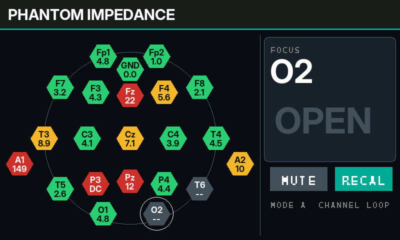

# Using the meter

For instructors and students running a training session on the phantom.

## Before a session

1. Head harness in **J1**, Electro-Cap in **J2**, ear electrodes in the **A1/A2** jacks.
2. Plug in the charger. The calibration report appears; check the **4.70 k check** line is green, then tap **CONTINUE** (or press the footswitch).
3. Every site starts grey (OPEN). That is correct until gel is in.

If the cap or head harness was swapped since the last session, nothing needs redoing: calibration runs at every power-up, and the per-site zero belongs to the board, not the cap.

## The screen

*Rendered preview of the layout with example values, not a photo of a session.*

| Part | What it shows |
|---|---|
| Header | Title, the **scan bar** (22 segments fill as the background scan goes round, turning green for a moment when a full scan finishes, with that scan's duration), and the board's die temperature in °F. **Tap the header to switch Mode A / B.** During a salt-bridge alarm the header turns red and names the pair. |
| Head map | One hexagon per site, seen from above with the nose at the top. Each shows the site name and its impedance in kΩ (one decimal below 10 k, whole numbers above). **Tap a site to focus it**; it is then re-measured several times a second. |
| Focus card | The focused site in large type, its reading, and the electrode's DC offset in millivolts. |
| MUTE | Silences the bridge alarm for the bridges present now. A new bridge un-mutes it. |
| RECAL | Re-measures VREF, reruns self-calibration and shows the report; CONTINUE returns to the map. |
| Mode line | `MODE A  CHANNEL LOOP`, or in Mode B `REFS VALID` (green) / `FIX A1`, `FIX A2`, `FIX A1+A2` (red). |

### Colours and readings

| Hexagon | Meaning |
|---|---|
| Green | ≤ 5 kΩ: passes |
| Amber | 5–10 kΩ: close, keep working |
| Red, with a number | > 10 kΩ |
| Grey, `--` | OPEN: no current flowed (no gel contact, electrode off the insert, or nothing plugged in) |
| Red, `DC` | the electrode's DC offset is too big to measure through (over about 1.45 V on the bench board) |
| Flashing red/white | part of a salt bridge |

The 5 kΩ pass mark applies to the **displayed** value. Scalp sites and GND are shown at half their true ohms (`PHANTOM_SCALE` 0.5) so that a careful prep on the skinless phantom lands where it would on a head; the ears are shown in true ohms. The reasoning is in [how it works §8](how-it-works.md#8-phantom-scale-making-a-plastic-head-read-like-a-scalp).

### LEDs on the carrier

| LED | Lit when |
|---|---|
| LED3 green | power |
| LED1 yellow | Mode B |
| LED2 green | references valid: each ear under 5 kΩ |

## Prepping a cap

1. Tap a site, or press the **footswitch**: a short press jumps to the next site still above 5 kΩ (an OPEN site counts as still to do).
2. Work the gel in. The focused site updates about three times a second.
3. A **chime** sounds when the focused site drops to 5 kΩ. It does not chime again unless the site rises back above 5.25 kΩ first, so a reading hovering on the line stays quiet.
4. Press the pedal for the next site. When every site passes, the panel says **ALL SITES PASS**.

Holding the pedal for one second toggles Mode A/B; `HOLD = MODE` appears after 0.4 s so a long press is never a surprise, and a short chirp confirms the change.

## Mode A and Mode B

- **Mode A** (default) measures each site against its own electrode. Use it to prep.
- **Mode B** measures each site against the ear references, as a clinical meter does, then separates the site from the ears arithmetically. Use it to check the references and to show students why a "bad site" can really be a bad reference. Both ears must read under 5 kΩ for `REFS VALID`. A scan takes about twice as long in Mode B.

## Salt bridges

When gel connects two neighbouring sites:

- both hexagons flash red/white and an **arrow** points to the **downhill** site, where the gel pooled. Clean that one first;
- the header turns red and names the pair (the steepest, lowest-impedance one first, with "+N" if there are more);
- a triple beep, then one beep a second (or the `saltbridge.wav` loop) until it clears or you tap **MUTE**.

A bridge is declared below 50 kΩ between the two sites and cleared above 80 kΩ. GND is not checked for bridges, because on this phantom its insert is only 4 mm from Fz; it still has to be prepped like any site.

## Sounds (optional)

With an 8 Ω speaker on the CrowPanel's SPK socket and a microSD card holding these files in its top folder, they replace the piezo for each event:

| File | Plays |
|---|---|
| `opening.wav` | once at power-up (calibration waits for it; a tap skips it) |
| `click.wav` | each tap on a site |
| `modechange.wav` | Mode A/B change |
| `saltbridge.wav` | looped while a bridge is present, until MUTE |

Uncompressed PCM WAV (Audacity: *Export as WAV, Signed 16-bit PCM*), mono or stereo, 8–96 kHz, up to 30 s. A missing file falls back to the piezo. The calibration screen lists which files loaded.

## Care

- Wipe gel off the inserts after each session; dried gel on an insert raises its floor.
- Keep gel away from the carrier board and the display. If the electronics go into a base under the head, put the vents low on the sides, never on top, keep printed plastic 10 mm clear of the ESP32-S3 module and the regulator, and prefer PETG to PLA for a base that carries the head's weight.
- This is training equipment for a plastic head. It has no patient isolation: **never connect it to a person.**
