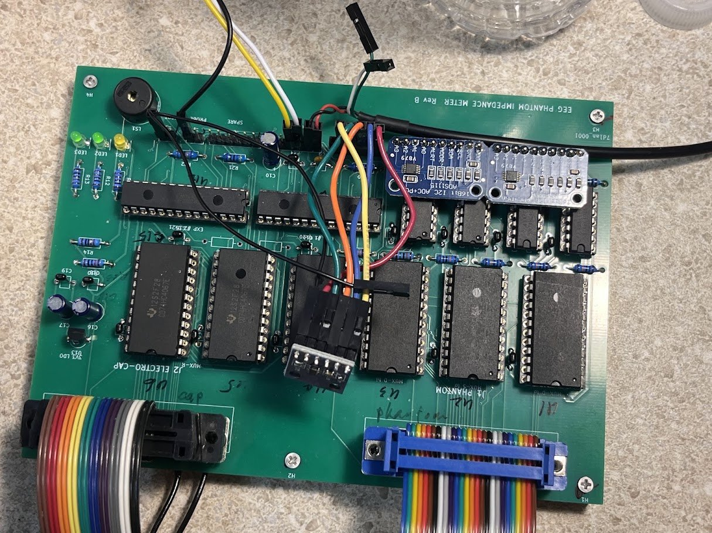
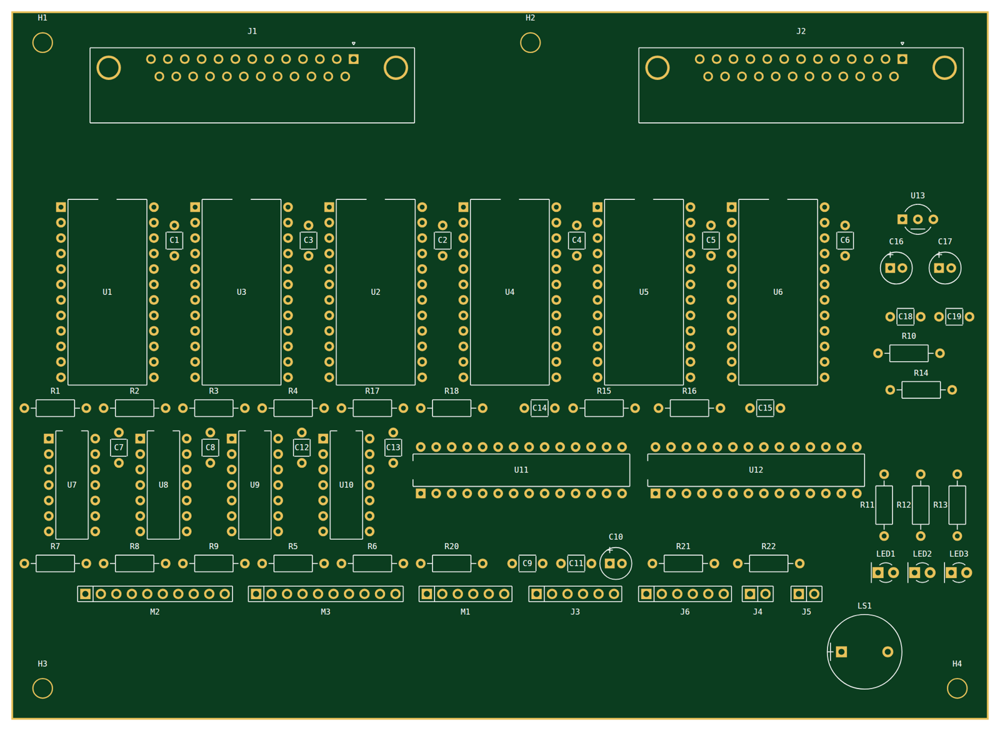
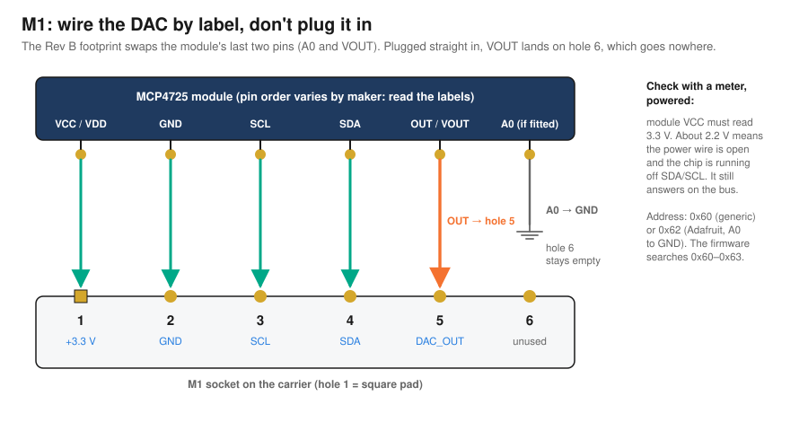

# Hardware: carrier board Rev B

A 160 × 116 mm two-layer board, all through-hole, every chip socketed and every fine-pitch part on a plug-in module. It holds the switch fabric, the analog front end and the calibration standards; the display board runs the firmware and talks to it over I²C.

| The bench board | As designed (placement) |
|---|---|
|  |  |

The photo is rotated 180° relative to the drawing. The small blue board on jumper wires in the middle of the photo is the MCP4725 DAC, hand-wired to the M1 socket (see [change 2](#2-m1-mcp4725-dac-hand-wired-not-plugged-in)).

- **Bill of materials:** [`bom.csv`](bom.csv), with what is fitted, linked or left out on the bench build.
- **Pinouts, channel map, I²C addresses, expander bits:** [`pinout.md`](pinout.md).
- **Routed copper:** [`img/pcb-routed.png`](img/pcb-routed.png) (red top, blue bottom).
- **KiCad design files:** see [Design files](#design-files).

## Board facts

| | |
|---|---|
| Size | 160 × 116 mm, 1.6 mm FR-4, 2 copper layers, 1 oz, HASL |
| Track / clearance | 0.30 mm signal, 0.50 mm power, 0.25 mm clearance |
| Vias | 0.8 mm pad, 0.4 mm drill |
| Holes | DIP and resistor 0.8 mm, headers and DB25 pins 1.0 mm, four M3 mounting holes |
| Ground | 0.5 mm tracks, no pours (pours gave starved thermal reliefs; at 2.5 µA and 31 Hz they buy nothing) |
| Checks | 109 nets complete; KiCad DRC on 11 Sep 2026: 0 unconnected pads, 0 footprint errors, 0 clearance errors |
| Parts cost | roughly $110 for the board and its parts at Oct 2026 single-unit prices, plus the display |

## Changes from Rev B as fabricated

The bench instrument works, but not as a stock Rev B. Anyone building another one from these boards needs all of the following. Each one is a design error or a lesson from bring-up, and each is fixed in the Rev C list below.

### 1. J1, J2: vertical DB25 connectors

The two DB25 footprints were drawn mirrored, so a right-angle connector faces into the board. The hole pattern and pin numbering are correct for a connector mating from above, so **vertical (straight) female DB25 PCB connectors** drop into the same holes with no modification and the cables plug in from the top. Right-angle parts cannot be used on these boards.

### 2. M1: MCP4725 DAC hand-wired, not plugged in

The M1 footprint has the module's last two pins swapped (A0 and VOUT). Plugged straight in, VOUT lands on hole 6, which goes nowhere, and the A0 pin sits on the DAC-output net. The fix is five jumper wires, matched **by label**, so any MCP4725 module works:

Two things worth knowing from bring-up:

- **An adapter PCB was tried and failed.** Its VDD connection was open; the DAC kept answering on I²C while running off its own data lines at about 2.2 V, its output was 0.68× what the firmware expected, the current pump sat against its rail and the test current read 0.3 µA instead of 2.5. *A chip that answers on the bus is not necessarily powered.* Measure the module's VCC pin: it must read 3.3 V.
- Generic modules answer at **0x60**, Adafruit's at **0x62** (A0 tied to GND). The firmware searches 0x60–0x63.

### 3. M3: ALERT pin tied to the current signal

On the M3 socket (the current-channel ADS1115 at 0x49), hole 6, which receives the module's **ALRT** pin, is joined to TIA_OUT, the same net as the module's A0 input. ALRT is an open-drain output, and the Adafruit ADS1X15 library switches it to conversion-ready mode on every read. From then on the ADC pulls the transimpedance output to ground between conversions, and calibration reports every standard OPEN on a board whose analog chain is fine.

- **Firmware workaround, already in place:** `phantom_meter_v2` and `pm_analog_probe` talk to both ADS1115s through their registers with the comparator off, so ALRT stays high-impedance. No library read is ever made on 0x49.
- **Hardware fix, optional:** clip pin 6 (ALRT) off M3's header so it cannot reach the socket. Until you do, **don't run any other sketch that uses the Adafruit ADS1X15 library on 0x49.**

### 4. R8: wire link, sense gain 1

The tin electrodes and carbon-filled inserts in Electro-Gel sit at about 0.5 V DC per site. At the stock gain of 4 that drove the sense amplifier into its rails and every site read "DC". A short wire across R8 makes U10A a follower (gain 1) and raises the tolerance to about 1.45 V. The firmware constant `G_SENSE` must match: `1.0f` linked (as shipped here), `4.0f` stock.

### 5. Ear electrode jacks on J2 pins 11 and 24

The Electro-Cap used here has separate ear electrodes on 1.5 mm touch-proof (DIN 42802) leads, so the cap's DB25 carries only the scalp sites. Two panel-mount touch-proof receptacles are soldered to the underside joints of **J2 pin 11 (A1)** and **J2 pin 24 (A2)**. Find each joint by continuity from the front of J2, then check 11 against 10 and 12, and 24 against 23 and 25, for shorts. First confirm the cap's own plug has nothing on pins 11 and 24.

### 6. Power and the display connection

The CrowPanel's connectors supply 3.3 V only, never 5 V. The carrier gets its own 5 V from the second port of the same charger, through a pigtail into J3 pins 1–2. The CrowPanel I²C cable's 3V3 wire is **cut back and insulated**: J3 pin 1 has no blocking diode, and tying the display's 3.3 V rail to it back-feeds 5 V into the ESP32-S3. Full wiring: [`docs/img/display-wiring.svg`](../docs/img/display-wiring.svg).

### Not fitted or not used

| Item | Why |
|---|---|
| R15, R16 (I²C pull-ups) | The modules' own pull-ups carry the bus, display devices included. Fit them only if addresses drop in and out. |
| J3 pin 5 (DRDY) | The ADC data-ready line was dropped on 17 Oct 2026; the firmware polls. Leave it unconnected. |
| J4 and switch S6 (probe) | Hardware for a "Learn Harness" feature that was never written. |
| J6 (six spare expander lines) | Spare. |
| DG1 loop-back dongle | Only needed for caps whose ear electrodes are inside the DB25. |

## About the multiplexers

The six CD74HC4067E in this build are marked as Texas Instruments parts, but TI no longer makes the through-hole version: Digi-Key lists the PDIP-24 `CD74HC4067E` as obsolete, and TI's current datasheet lists only SOIC, SSOP and TSSOP packages. The build guide's parts search found the other through-hole 16:1 muxes (CD4067BE, onsemi MC14067B) gone from Digi-Key and Mouser too, which is why these came from an Amazon/AliExpress 10-pack. Parts sold that way are old stock, remarks or clones; the marking alone cannot tell you which.

The design tolerates that by construction:

- **On-resistance doesn't reach the answer.** The drive-side mux is outside the Kelvin loop, the sense-side mux carries no current, and the return-side mux sits at a virtual ground that never moves, so its resistance is a constant.
- **What is left is calibrated out.** The two-point fit, the short-channel offset and the per-site zero together remove the return path; on the bench, chip-to-chip differences of a few hundred ohms between U5 and U6 were removed this way.
- **A bad chip announces itself.** The open channel must read open (a stuck switch fails calibration with "a mux is stuck on"), and any site reading OPEN through the straight-through cable during ZERO SITES points at its channel.

Buy spares. If you want parts with a known origin, the TI SOIC-24 versions on SOIC-to-DIP adapter boards fit the same sockets, at the cost of hand-soldering six fine-pitch chips.

Sources: [Digi-Key, CD74HC4067E](https://www.digikey.com/en/products/detail/texas-instruments/CD74HC4067E/1507234) · [TI CD74HC4067 datasheet](https://www.ti.com/lit/gpn/CD74HC4067)

## Rev C change list

Items 1–3 are the known layout errors. Items 4–7 fold in what bring-up taught; they are suggestions, not yet drawn.

1. J1/J2: flip the DB25 footprints so right-angle connectors face off the board edge (or keep vertical parts and say so on the silkscreen).
2. M1: correct the MCP4725 footprint pin order (A0 and VOUT swapped), or better, drop the socket and route to a labelled 6-pin header so any module can be wired.
3. M3: leave pad 6 (ALRT) unconnected.
4. U10A: change the sense gain to 1 (R8 to 0 Ω or a jumper, R9 not fitted), or make it selectable.
5. Add footprints for the A1/A2 touch-proof ear jacks on the J2 nets.
6. Add a 5 V input connector separate from J3, and a series diode or polyfuse on the 5 V input so a wrong wire cannot back-feed.
7. Optional: wire an MCP23017 interrupt output to the display if the footswitch should be interrupt-driven, and drop S6/J4 unless Learn Harness is going to be written.

## Design files

The KiCad project (`phantom_meter.kicad_pro`, `.kicad_sch`, `.kicad_pcb`, Freerouting `.dsn/.ses`) for Rev B lives in the original `phantom_meter_RevB_kicad.zip` and **is not in this repository yet**. Put its contents in [`kicad/`](kicad/) and commit them; the schematic is drawn label-style, so `Ctrl+F` on any net name in this documentation finds every pin it touches.

## Ordering bare boards

1. Open `phantom_meter.kicad_pro` in KiCad 8 or 9, open the PCB editor and run **Inspect → Design Rules Checker**. Expect zero errors. Silkscreen-overlap warnings are cosmetic.
2. **File → Fabrication Outputs → Gerbers**: layers F.Cu, B.Cu, F.Silkscreen, B.Silkscreen, F.Mask, B.Mask, Edge.Cuts; tick "Use Protel filename extensions". Then **Generate Drill Files**: Excellon, PTH and NPTH in one file, millimetres. Zip the folder.
3. At JLCPCB: 2 layers, 160 × 116 mm, 1.6 mm, HASL, 1 oz, qty 5, no assembly. Check that the preview shows two D-sub outlines along one edge.
