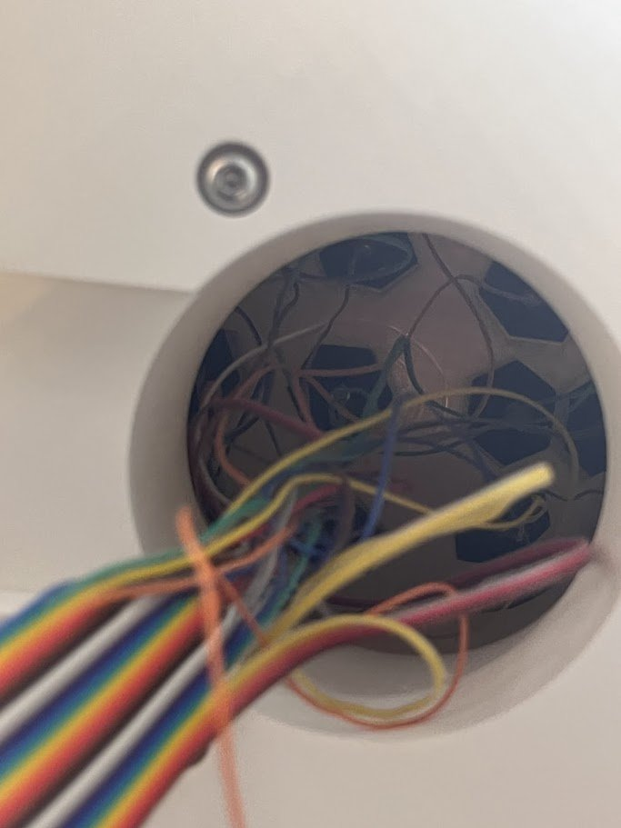
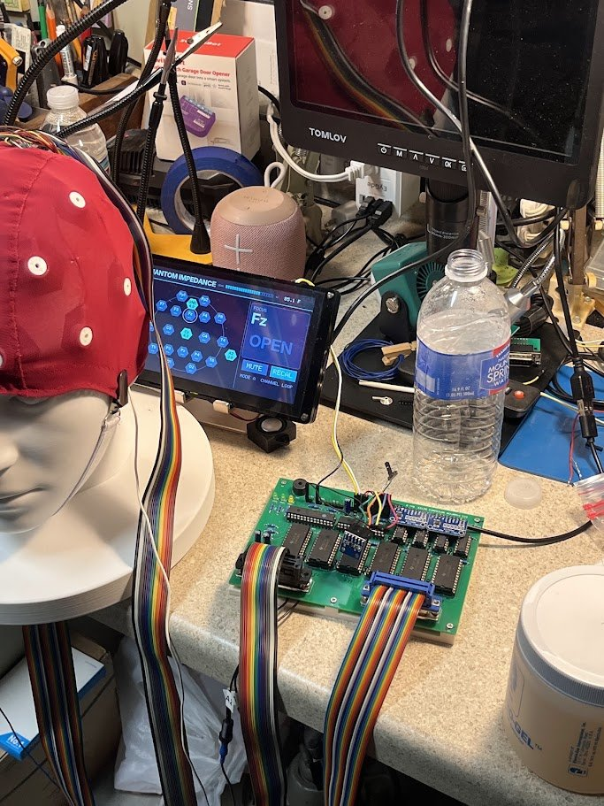

# The head phantom

A life-size head printed in standard (non-conductive) PLA, with a **hexagonal insert of conductive PLA at each 10-20 site**. Each insert has its own wire, run through the inside of the head to a DB25 male connector wired to the Electro-Cap pinout, so the head plugs into **J1** exactly the way a cap plugs into **J2**.

| Inside the head | On the bench |
|---|---|
|  |  |

## Why it is built this way

- **Inserts are isolated from each other.** Bare plastic sits between every pair of sites, so the only way current gets from an insert to anything else is through gel. That is what makes each site's reading a measure of the gel contact at that site, and what makes salt bridges detectable at all (see [how it works §1 and §9](../docs/how-it-works.md#1-what-the-meter-is-grading)).
- **One wire per insert, same pinout as the cap.** Site N on the head and site N on the cap use the same DB25 pin, so the firmware drives J1 pin N and returns through J2 pin N.
- **Ears.** A1 and A2 inserts sit where the ear electrodes clip on. The Electro-Cap used here has separate ear electrodes on 1.5 mm touch-proof leads; they plug into jacks wired to J2 pins 11 and 24.

## What is known about the inserts

- Printed with 2 walls, 100 % infill, rectilinear pattern: this gave the lowest and most consistent resistance across sites.
- Measured 300–610 Ω per insert, bare.
- With tin Electro-Cap electrodes and Electro-Gel, each site behaves like a small battery, about 0.44–0.5 V DC, and after careful prep sits on a floor of roughly 4–13 kΩ set by its two junctions (there is no skin to abrade). The meter's `PHANTOM_SCALE` compensates for teaching purposes.
- **GND and Fz inserts are only about 4 mm apart.** Gel from Fz almost always reaches the GND insert, so GND is left out of salt-bridge checking by default. Shrinking the GND insert was considered and rejected: it would remove the alignment leeway real cap placement has.

## Files

The CAD and print files for the shell and inserts are **not in this repository yet**. Add them here (for example `phantom/cad/` and `phantom/stl/`) with the slicer settings above.
